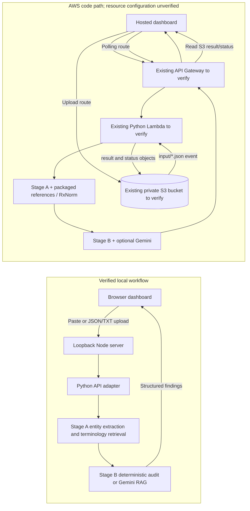

# System design

The root [README](../README.md) is authoritative for the current repository/AWS inventory, deployment status, environment variables, and test outcomes. The diagram distinguishes the locally verified workflow from AWS code paths that are not yet account-verified.

## Data flow and boundaries

- Local Node serves the existing static frontend and invokes `scripts/run_web_api.py`; it binds to loopback. A local upload is processed locally and kept in memory for the browser job lookup. It is not an S3 upload.
- `POST /api/analyse` validates one transcript, runs Stage A and Stage B, and returns findings without echoing transcript bodies.
- `POST /api/upload` is prepared as an API Gateway/Lambda route. In AWS, it validates one `.txt` or `.json` file and writes normalised input under the verified bucket's `input/` prefix. The S3 notification runs the same Lambda handler.
- S3-triggered Lambda outputs audited results and non-PHI job status under `output/stage_b/`. `GET /api/jobs/{jobId}` reads those objects for dashboard polling.
- Stage A retrieves RxNorm/ICD evidence; Stage B uses evidence in RAG mode when configured, or runs a deterministic fallback. Gemini credentials remain server-side.
- No DynamoDB, queue, Step Functions, Cognito, frontend hosting resource, or API Gateway resource is declared in this repository. AWS resource existence/configuration and authentication must be verified with the account owner.
- The reviewer confirms findings; the application does not diagnose or update an EHR.
