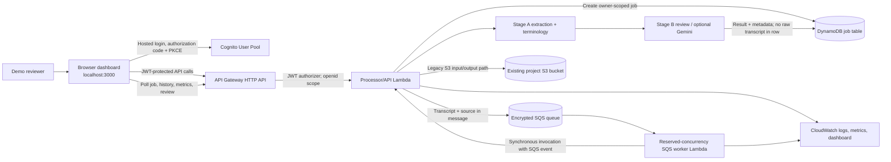

# High-Level Design (HLD)

**System:** EHR Compliance Monitor research prototype

**Document status:** implementation-aligned design, checked 16 October 2026

**Audience:** project reviewers, developers, and demo operators

## 1. Purpose and scope

The service reviews candidate clinical documentation and returns structured signals for a human reviewer. It combines deterministic entity extraction and terminology retrieval (Stage A) with deterministic or optional Gemini-based review (Stage B). The web application also supports synthetic chart-context import from one Synthea FHIR R4 Bundle.

This HLD describes the checked-in implementation and the AWS classroom demo. It is not a production deployment specification or a statement of clinical, privacy, security, or regulatory certification. Intended use is synthetic data in a research demonstration. The service does not update an EHR, diagnose, prescribe, or replace qualified review.

## 2. System context

The **dashboard job flow** is asynchronous through SQS and DynamoDB. The processor Lambda also retains a legacy S3 event path and a synchronous `/api/analyse` API route. The latter is not the dashboard’s main job workflow. Exact deployed resource configuration and checks are recorded in the dated [AWS deployment report](AWS_DEPLOYMENT_REPORT_20261016.md); AWS resources are not provisioned from this repository’s IaC.

## 3. Deployment modes

| Mode | Request path | Persistence | Intended scope |
|---|---|---|---|
| Local | Browser → local Node server → Python adapter/pipeline | Single-process JSON file under `.ehr-local-data/` | Developer and classroom demonstration with synthetic text |
| AWS demo | Browser → Cognito → API Gateway → processor Lambda → SQS → worker Lambda → processor/pipeline | Owner-scoped DynamoDB metadata/results; SQS carries input transiently; legacy S3 path remains | Authenticated localhost demonstration with one-day retention settings |

These modes share the frontend and clinical pipeline code but are not operationally equivalent. Local JSON persistence has no multi-process coordination. AWS queue delivery is at-least-once and depends on conditional job-state handling. Local mode has no cloud auth boundary.

## 4. Major components

### Browser application

Provides transcript input, Synthea FHIR chart-context import, job status/history, findings, source comparison, system health, and review actions. In AWS mode, Cognito OAuth authorization-code flow with PKCE is performed in the browser. The client keeps OAuth tokens in `sessionStorage`; this is appropriate only for this constrained demo and is an XSS-sensitive design choice. FHIR import executes locally in the browser; the original FHIR JSON is not uploaded by that feature.

### Local Node service

Serves static assets and runtime public configuration, handles same-origin local APIs, validates/transforms uploads, and starts local asynchronous jobs. It delegates pipeline work to a Python process and stores local history as JSON. It binds to loopback by default and is not a production web server.

### API Gateway and Cognito

The deployed HTTP API uses a Cognito JWT authorizer for application routes; `GET /health` is public. JWT subject (`sub`) is used as the job owner. OAuth callback/logout and API CORS are restricted to `http://localhost:3000/`; no hosted UI origin is configured. Authentication identifies a demo account, not a clinical role or institution.

### Processor/API Lambda

The Python Lambda handles authenticated API requests, SQS worker events, and the retained S3 event route. It validates transcript input, calls Stage A and Stage B, writes owner-scoped job state/results, and returns structured responses. Its execution role is distinct from the worker role. Do not infer that an API route or data path is production-approved from its presence in source.

### SQS and worker Lambda

The encrypted standard SQS queue and DLQ provide asynchronous delivery, configured with a 20-second receive wait, 90-minute visibility timeout, one-day retention, and redrive after four receives. The reserved-concurrency-2 worker invokes the processor Lambda synchronously with the received SQS event. The worker reports failed batch items when its invocation path fails; application-level processing failures are persisted as failed job state. Queue delivery can repeat, so worker state claims must remain conditional/idempotent.

### DynamoDB

The encrypted on-demand table stores job owner, IDs, state, timestamps, expiry, content hash, result/findings, and reviewer/audit metadata. It does not store raw transcript text. A `ByOwnerSubmittedAt` index supports owner-scoped history. Application code checks expiry because DynamoDB TTL removal is asynchronous. Result objects can contain excerpts and generated output; these remain sensitive even when source text is excluded.

### Pipeline and external services

Stage A extracts diagnoses/medications and attaches RxNorm or ICD-10-CM reference evidence using the local indexes and terminology path. Stage B can run deterministic review or optional LLM review with Gemini; the selected mode is controlled server-side. External terminology providers and Gemini are separate data recipients when their paths are used. Their data handling and terms must be reviewed before any real data use.

### S3 compatibility path

The processor retains a legacy upload/event path for the configured project bucket. Objects under `input/` can trigger processing; results/status/lock objects use `output/stage_b/`. The 16 October demo lifecycle policy expires objects under the existing `input/` and `output/stage_b/` prefixes after one day. This path is separate from the DynamoDB-backed dashboard queue and must not be confused with it.

## 5. Primary data flows

### Asynchronous dashboard job

1. User signs in; the browser completes PKCE and obtains a bearer token.
2. Browser submits candidate text and optional trusted source to `POST /api/jobs` or `POST /api/upload`.
3. API Gateway validates the JWT. The API derives owner from JWT claims, validates request shape/length, creates a `QUEUED` DynamoDB item with an expiry, and sends transcript/source in an SQS message.
4. Worker receives the message; the processor claims the job conditionally, runs Stage A and Stage B, and persists result and status.
5. Browser polls `GET /api/jobs/{jobId}` and can query owner-scoped history/overview or append review actions.
6. Queue, DynamoDB TTL, S3 lifecycle, and log retention are configured for one day in this demo. They do not guarantee immediate or complete deletion.

### FHIR chart-context import

1. User chooses one FHIR JSON Bundle in the browser.
2. The `EhrFhirImport` parser enforces local size/resource/output limits, requires one Patient, rejects cross-patient references, skips unsupported types, and renders supported chart fields as text.
3. The generated summary is placed in the trusted-source field; if the candidate field is empty, it is also copied there for editing.
4. Only the text in the two fields is sent through the regular job API. The app does not create an original-note transcript from FHIR and does not preserve the uploaded Bundle.

### Local job

The browser calls the local Node API. A local job record is created, Python processes the candidate/source, and result/state are written to the single-process local JSON store. Raw candidate/source strings are not intentionally persisted as job inputs; result fields may include excerpts, so treat the local store as sensitive.

## 6. Trust boundaries and data classification

| Boundary | Data crossing it | Design control in demo | Important limit |
|---|---|---|---|
| Browser ↔ Cognito | Demo credentials, OAuth codes/tokens | PKCE, state validation, session storage | Browser XSS can expose session data; no production identity review |
| Browser ↔ API Gateway | Transcript/source, job IDs, result/review data | TLS, JWT authorizer, CORS allowlist | CORS is not authorization; API route auth is the control |
| API ↔ SQS | Candidate/source text and job ID | Encrypted queue, short retention | Queue necessarily holds submitted text while pending/processing |
| Worker ↔ processor | SQS event payload | IAM-scoped invoke and queue roles | Requires least privilege and failure/replay monitoring |
| Lambda ↔ DynamoDB | Owner/job metadata, generated results, excerpts | Encryption, owner condition/query, app expiry checks | Results and audit notes can be sensitive; TTL is asynchronous |
| Lambda ↔ S3 (legacy path) | Input record and audited output | Scoped project prefixes and lifecycle | Validate public access block, encryption, role, and notification configuration |
| Pipeline ↔ external services | Terminology terms; optionally prompts/transcript context | Server-side integration and no browser secrets | Vendor terms/data retention are not a production approval |

## 7. Security, privacy, and operational controls in the demo

- Cognito self sign-up with email verification, public app client (no client secret), OAuth authorization code + PKCE, optional TOTP MFA, and 12-character mixed-class password policy.
- API Gateway JWT authorizer protects application routes and requires the configured `openid` scope. Only the health check is public.
- Owner identity is extracted from the verified JWT. Job reads and history use owner conditions; review appends audit events for that owner.
- SQS, DynamoDB, and documented logs are encrypted/configured as described in the deployment report. Queue messages, DDB records, S3 prefixes, and project processor/worker logs have one-day lifecycle/retention settings.
- Logs are intended to record event/error types and aggregate counters, not transcript bodies. Prompt persistence is optional and should remain disabled outside controlled debugging.
- The dashboard is limited to localhost. No production frontend origin, clinical role model, or institution federation is configured.

These controls reduce demo risk but do not make the system production-ready or certify regulatory compliance.

## 8. Reliability and observability

- SQS is at-least-once. Conditional status updates and worker claims prevent normal duplicate execution; expired/stuck processing and redrive behavior require operator monitoring.
- The queue DLQ retains failed messages for one day. The deployment has no configured alarm actions; dashboard charts are not an incident response program.
- CloudWatch dashboard `ehr-compliance-demo` charts Lambda errors/invocations/duration and queue/DLQ visible message counts. Application metrics include job success/failure, duration, and finding counts.
- Cloud dependencies include Cognito, API Gateway, SQS, DynamoDB, Lambda, S3 (legacy path), CloudWatch, RxNorm/network access, and optional Gemini. Failure of external terminology/LLM calls may produce fallback or failed results; fallback output must be displayed as such.
- No tested backup/restore, RTO/RPO, failover region, load/capacity target, or end-to-end alerting coverage is claimed.

## 9. Production-readiness gaps

Do not promote the demo to production by changing only the frontend URL. A production program needs an approved intended-use and clinical safety case; independent clinical validation; privacy/regulatory assessment; data processing agreements; threat modeling and security testing; production identity/role and reviewer authorization; XSS/token-storage hardening; secrets rotation; complete data inventory and deletion verification (including queue, logs, backups, model providers, and derived result excerpts); tested recovery, load, quotas and cost controls; monitored SLOs and incident response; and change-controlled release/deployment infrastructure. Each gap requires owner, evidence, and approval before real patient data is considered.

## 10. Related documentation

- [LLD](LLD.md) for API/resource schemas, validation, state transitions, and module detail.
- [README](../README.md) for setup, user workflow, commands, and repository map.
- [AWS deployment report](AWS_DEPLOYMENT_REPORT_20261016.md) for deployment evidence and demo operating instructions.
