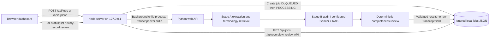

# EHR Compliance Monitor implementation report — 16 October 2026

> Historical local-implementation report written before AWS deployment. Its cloud status is superseded by [AWS deployment report](AWS_DEPLOYMENT_REPORT_20261016.md).

## What was implemented

- Preserved the existing deterministic Stage A extraction/RxNorm/ICD retrieval, Stage B deterministic/Gemini/RAG paths, structured response validation, and explicit fallback status.
- Added a deterministic clinical completeness review. It reports `present`, `not_mentioned`, `potentially_missing`, `ambiguous`, or `not_applicable`; missing dosage is suggested only when a medication is explicitly instructed. It never fills in a medication, dosage, diagnosis, route, or frequency.
- Fixed section-boundary extraction: an empty `ASSESSMENT:` or `PROCEDURE:` header no longer consumes the following section, and an inline `PLAN:` after a period ends a diagnosis span.
- Replaced the one-screen testing UI with Overview, New Verification, History, Verification Details, and System Health views, responsive tables/cards, status/error/empty states, severity distribution, source evidence, completeness signals, finding provenance, and review controls.
- Added a local asynchronous job workflow and durable single-process job store at `.ehr-local-data/jobs.json` (ignored by Git). A job stores metadata, validated results, evidence, review status, and audit events; it does not store the submitted transcript field. Result excerpts and extracted phrases can still contain sensitive clinical text, so use synthetic or authorised data only.
- Added active-job deduplication and a content cache keyed by conservative NFKC/line-ending/outer-whitespace normalization, source text, Stage A/Stage B code, completeness/API code, prompt files, terminology reference files, Stage B mode, and model setting. Failed or fallback results are not cacheable. A new request record records cache reuse; a forced rerun bypasses the cache.
- Added append-only review events for mark-reviewed, dismiss, and escalate actions. Dismissed findings remain in the result. The local workflow does not authenticate the reviewer; it records `unauthenticated local demonstration session` rather than inventing an identity.
- Included the completeness module in the existing Lambda ZIP builder so a future, reviewed deployment package can import it.

## Implemented architecture



`POST /api/analyse` remains available for the existing synchronous direct API contract. The new local dashboard uses the new same-origin job/history/review APIs. The JSON store is suitable only for this single-process classroom demonstration; it is not DynamoDB and does not coordinate multiple server processes.

## Frontend and demo workflows

- **Overview:** job-level counts, completed/active/failed counts, jobs requiring human review (each job counted once), mean recorded duration, cache-hit rate, recent activity, and finding counts by severity. Metrics are derived from stored jobs; empty history shows zero/empty values.
- **New verification:** paste or upload one `.txt`/`.json`; backend validates content and size; submission returns a job ID and UI polls status. Synthetic example remains available.
- **History:** filter by job status, review state, date, and job ID; retrieve pages of 20; click a row to load the stored record.
- **Details:** job timestamps, duration, cache status/source job, pipeline version, entities, Stage A/Stage B evidence and provenance, completeness review, source comparison, and append-only audit entries.
- **Review:** mark a job reviewed, dismiss a finding with a reason, or escalate a finding with a reason.
- **System Health:** reports local backend, local background executor, active local jobs, and recent failures. It explicitly marks AWS queue/dependency health unavailable.
- **Visual check:** rendered a 1440×1000 headless Chrome screenshot of the Overview page. The CUA bridge had no attached browser tab; this was not an interactive browser session.

## Existing AWS inventory (read-only, `ap-south-1`)

| Component | Observed state |
|---|---|
| API Gateway | Existing HTTP API `ehr-compliance-api`, `$default` stage, routes for health, analysis, upload, and job lookup. All inspected routes have `AuthorizationType=NONE`. |
| Existing Lambda | `ehr-compliance-stage-b`, Python 3.12, `stage_a_handler.lambda_handler`, 900-second timeout, 1024 MB, no VPC. API integrations are set to 30 seconds. Current deployed code hash differs from the locally rebuilt ZIP (which now includes completeness review). |
| S3 | Existing `ehr-compliance-monitor-yogiri-2026` bucket; public access block enabled; AES256 encryption enabled; input-prefix event notification targets the existing Lambda. No lifecycle rule; versioning is not enabled. |
| Lambda IAM | Existing execution role has AWS Lambda basic logging plus one inline S3 policy scoped to the project bucket's input/output object prefixes and a conditioned output-prefix list permission. No SQS/DynamoDB permissions were observed. |
| DynamoDB / SQS | No tables or queues found. |
| EC2 | No instances found. The existing backend is Lambda-based, so no duplicate EC2 deployment was created. |
| CloudWatch | Lambda log group exists with no retention setting; no dashboard found. |
| Cognito | No user pool was returned by the regional inventory query. |
| Cloud changes | None made. No Lambda, API Gateway, IAM, S3, queue, table, logging, or hosting resource was modified or created. |

The live `GET /health` endpoint returned `ok` and reported S3 upload configured. This does not prove Gemini calls, every S3 operation, deployed-package parity, or production readiness. The local package hash mismatch means the current deployed Lambda does **not** include the newly implemented completeness response.

## Cloud architecture proposed, not implemented

The following is the smallest queue/database extension consistent with the current code and with leaving the existing S3 notification path intact. It must not be deployed before authentication and retention decisions are made.

- **DynamoDB table (proposed `ehr-compliance-jobs`):** on-demand capacity, AWS-managed encryption, point-in-time recovery only if the retention/cost decision supports it. Base key `PK=JOB#<uuid>`, `SK=META`. Store timestamps, status, content/pipeline key, duration, result metadata/findings, error category, cache source, review state, and append-only audit actions. Do not put raw transcript text in the item. Proposed GSIs: status + submission time for status-filtered history, and review state + submission time for review queues. Paginate every query; do not scan the table for overview metrics.
- **SQS (proposed standard main queue plus DLQ):** SSE-SQS; 20-second long polling; one message per invocation; maximum receive count 4; visibility timeout at least 5,400 seconds for the current 900-second Lambda maximum, with the worker extending visibility while needed. Configure partial batch failure reporting and cap worker concurrency to protect Gemini quotas. SQS is at-least-once; Dynamo conditional state transitions make repeat delivery safe. Do not automatically redrive the DLQ.
- **Input handling:** the worker needs transcript data without a DynamoDB duplicate. The current S3 bucket is encrypted/private but has no lifecycle policy. A separate non-triggering prefix or SQS payload could carry the input; each choice has retention and PHI exposure tradeoffs. Do not route a new prefix into the current `input/` S3 notification because that would execute the existing worker path twice.
- **Existing API security:** the HTTP API is currently unauthenticated. A public frontend plus CORS is not authentication. Use an existing approved identity provider or decide whether to introduce one; the regional inventory returned no Cognito user pool. Do not make review/history endpoints public before choosing an authorizer and reviewer identity model.
- **CloudWatch:** add a retention period only after deciding how long operational logs must be retained; the current log group is indefinite. Keep transcript bodies, prompts, API keys, and patient identifiers out of logs.
- **No EC2:** the existing Lambda is already the backend and has the needed runtime. EC2 would duplicate the current backend without improving this short demonstration path.

This requires updating the existing Lambda package/handler, API route behavior, Lambda IAM policy, SQS event source mapping, and DynamoDB access. Those are security-sensitive changes to a live unauthenticated clinical-data API. The concrete inventory is provided here before seeking approval; no deployment was performed.

## Cache, idempotency, and state behavior

- Local states: `QUEUED → PROCESSING → COMPLETED|FAILED`; process restarts mark abandoned local jobs failed because the local runner does not retain raw input for recovery.
- Active equivalent submissions return the existing active job ID. The cache key preserves internal transcript whitespace and only normalizes Unicode to NFKC, line endings, and leading/trailing whitespace.
- Cache entries require a completed, schema-valid result and a matching code/prompt/model/terminology fingerprint. A Gemini fallback and a failed result are not cached. Explicit `forceRerun=true` bypasses completed-result reuse.
- SQS/DynamoDB idempotency, durable queue retry, DLQ recovery, and cloud cache metrics are **not implemented**.

## Security and data handling

- Local HTTP listener binds to `127.0.0.1`; request and upload sizes are checked server-side; unsupported file types are rejected.
- Local job storage is Git-ignored and omits the raw transcript. It stores extracted phrases and evidence, which may still be sensitive; no real patient data should be used.
- Python Stage B fallback remains visibly distinct from a successful Gemini response. No LLM success was fabricated; no live Gemini request was made during testing.
- Review actions are unauthenticated local demo events. They are not attributable to a verified individual.
- The existing AWS public API has no authorization, bucket retention is undefined, log retention is indefinite, and no HIPAA/GDPR compliance or production suitability is claimed.

## Files changed or added

- Added: `docs/BASELINE_REPORT_20261016.md`, `docs/IMPLEMENTATION_REPORT_20261016.md`, `src/backend/completeness.py`, `src/backend/local_jobs.js`, `tests/test_completeness.py`, and `tests/test_local_jobs.js`.
- Updated: `README.md`, `.gitignore`, `package.json`, `src/backend/server.js`, `src/backend/web_api.py`, `src/backend/stage_a/extract.py`, `src/backend/stage_b/audit.py`, `src/backend/stage_b/stage_b.py`, `src/frontend/index.html`, `src/frontend/app.js`, `src/frontend/styles.css`, `scripts/build_lambda.py`, `tests/test_extract.py`, `tests/test_handler_zip.py`, `tests/test_stage_b.py`, and `tests/test_stage_b_llm.py`.
- A rebuilt Lambda ZIP and UI screenshot are under ignored `build/`; no generated bundle or cloud resource was deployed.

## Commands and verification

```powershell
$env:STAGE_B_MODE = "stage_a_only"
npm.cmd run check
npm.cmd run test:local
python -B -m pytest -q -p no:cacheprovider --basetemp build\pytest-final-20261016 tests
python scripts/build_lambda.py
npm.cmd start
```

- Baseline before changes: **100 Python tests passed**, JavaScript checks passed, and a 20-record deterministic pipeline run completed 20/20.
- Final regression: **111 Python tests passed**; **6 local Node job-store tests passed**; `npm run check` and `node --check src/frontend/config.js` passed; isolated Lambda ZIP test passed, and package build completed at 3.42 MB.
- Local HTTP workflow: submitted synthetic input, observed a real job ID and `QUEUED → COMPLETED`, retrieved history/details, saved review audit, submitted identical content and got a cache hit, restarted the server, and confirmed history/result/audit persisted without a top-level transcript.
- Completeness behavior: complete dose/frequency, missing dose with explicit instruction, medication/diagnosis absence, ambiguous medication wording, explicit not-applicable procedure, and section-boundary false-positive tests passed.
- Live AWS health endpoint: responded. Live Gemini, deployed package parity, API Gateway authenticated use, SQS/DynamoDB, AWS end-to-end, failure recovery, and CloudWatch metrics were not tested because no infrastructure was changed.
- Interactive browser console checks were unavailable; a headless Chrome render of the overview page was inspected. No mobile device rendering was run.

## Known limitations and safe operation

- The new dashboard features are local only. `.ehr-local-data/jobs.json` is a single-process JSON store, not a production database; local background tasks cannot recover their input after a process crash.
- The existing AWS site does not have the new queue/history/review APIs, has an unauthenticated public API, and is still on the old Lambda package. Do not send real clinical information to it.
- Stage A diagnosis/procedure extraction and completeness signals are heuristic. No span-level clinical accuracy benchmark or clinician adjudication was performed.
- Gemini/network tests, responsive mobile device test, AWS queue/DLQ retry test, and cloud deploy remain outstanding.
- Local shutdown: stop `npm.cmd start` with Ctrl+C. No AWS resources were created, so there is no new cloud resource to shut down. Do not terminate the existing Lambda/API/S3 resources as part of demo cleanup.
- Cloud costs did not increase from this session because there were no cloud changes. If approved later, SQS/DynamoDB low-volume on-demand usage is expected to be usage-based, but confirm the current regional price and storage retention before provisioning.

## Professor-facing explanation

The project is a two-stage clinical transcription review prototype. Stage A extracts medication, dosage, diagnosis, and procedure candidates and attaches terminology evidence. Stage B provides rule-based or explicitly labeled LLM-assisted contextual review; schema validation and a truthful fallback protect the response contract. A separate completeness panel distinguishes present, absent, ambiguous, and contextually expected information without inventing missing clinical facts. The local dashboard demonstrates asynchronous job status, history, explainable findings, and an append-only human-review audit. It does not diagnose, certify regulatory compliance, or write to an EHR.

## Five-minute demonstration script

1. **0:00–0:40 — Overview:** show live local job metrics and explain that they come from the persisted local store, not seeded production metrics.
2. **0:40–1:20 — New verification:** load the labeled synthetic example, submit, and point out the returned job ID and asynchronous status.
3. **1:20–2:10 — Result details:** show Stage A entities, terminology evidence, Stage B mode/status, and the completeness panel. Explain that absent fields are not automatically violations.
4. **2:10–3:00 — Finding explanation:** expand the entity evidence and distinguish a deterministic signal from an LLM suggestion/fallback. State that model confidence is shown only when reported.
5. **3:00–3:50 — Review audit:** mark reviewed or dismiss/escalate a synthetic finding with a reason; show the appended audit event and unauthenticated-demo identity label.
6. **3:50–4:25 — History/cache:** return to History, filter and reopen the job; resubmit identical content and explain version-aware cache reuse.
7. **4:25–5:00 — Operations and limits:** show local worker/queue measurements, label AWS metrics unavailable, and state that the AWS API is still unauthenticated and was not changed in this session.
