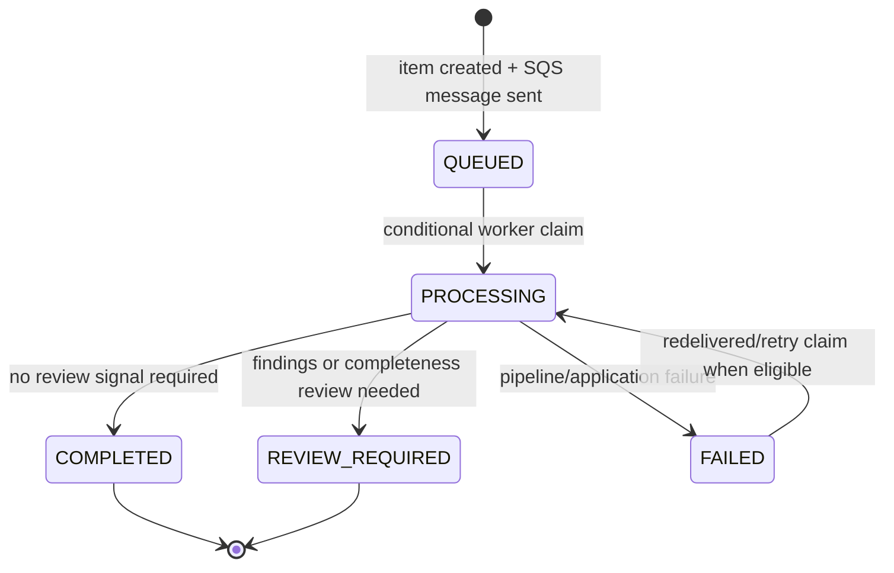

# Low-Level Design (LLD)

**System:** EHR Compliance Monitor research prototype

**Document status:** implementation-aligned design, checked 16 October 2026

**Companion:** [HLD](HLD.md)

## 1. Scope and implementation map

This document describes the concrete code path and the AWS demo shape. It is not a production specification. Source code is authoritative when a detail changes; update this document and the HLD with the same change.

| Module | Implementation responsibility |
|---|---|
| `src/frontend/index.html`, `app.js`, `auth.js` | Browser UI, auth-code + PKCE, transcript/job APIs, history/review, FHIR import UI |
| `src/frontend/fhir_import.js` | Pure browser-side FHIR Bundle validation and chart-context summary |
| `src/backend/server.js` | Local static server, API routing, request bounds, Python process delegation |
| `src/backend/local_jobs.js` | Single-process JSON-backed local job state, local cache, history, audit actions |
| `src/backend/web_api.py` | Transcript/source validation and orchestration of Stage A, Stage B, completeness review |
| `src/backend/cloud_jobs.py` | API Gateway request handling, Cognito claim ownership, DynamoDB/SQS submission, job/history/review, worker processing |
| `src/aws/lambda/stage_a_handler.py` | Lambda event dispatcher for HTTP API, SQS worker events, and existing S3 events |
| `src/aws/lambda/worker_handler.py` | SQS-triggered Lambda that invokes the processor Lambda and returns partial batch failures |
| `src/backend/stage_a/` | Candidate extraction, normalization, terminology retrieval/verification |
| `src/backend/stage_b/` | Deterministic/LLM review, prompt building, output validation, fallback |

## 2. Runtime and configuration

### Runtime modes

- **Local dashboard:** `npm start` starts the Node server (default `PORT=3000`). Node spawns `scripts/run_web_api.py`, which invokes the shared Python pipeline. Job records/results live in `.ehr-local-data/jobs.json`; storage is single-process and file-backed.
- **Cloud dashboard:** browser obtains a Cognito JWT, calls API Gateway, and the processor Lambda handles API requests. Async jobs use SQS, a worker Lambda, the processor Lambda, and DynamoDB. The direct synchronous `/api/analyse` path and legacy S3-trigger path remain in the Lambda handler.
- **Browser FHIR import:** no backend route or external parser package is involved. The uploaded JSON is read and summarized by `fhir_import.js`; then ordinary text is posted to the selected runtime.

### Environment settings

| Setting | Consumer | Purpose / handling |
|---|---|---|
| `PORT` | Local Node | Local HTTP port; defaults to `3000`. |
| `PYTHON_EXECUTABLE` | Local Node/build helpers | Python executable path; defaults per local script/runtime. |
| `PIPELINE_TIMEOUT_MS` | Local Node | Pipeline child-process timeout; defaults to 240,000 ms. |
| `STAGE_B_MODE` | Python pipeline/Lambda | `stage_a_only`, `llm_plain`, or `llm_rag`; defaults from key presence when unset. |
| `GEMINI_API_KEY` | Server/Lambda only | Gemini credential; must never be exposed in frontend/config/build output. |
| `GEMINI_MODEL`, `GEMINI_RPM` | Stage B | Model and application-side request pacing configuration. |
| `PERSIST_STAGE_B_PROMPTS` | Stage B | Optional sensitive prompt persistence; keep disabled outside controlled debugging. |
| `EHR_API_BASE_URL` | Browser runtime/build | Public API Gateway origin. Empty means same-origin/local APIs. |
| `EHR_COGNITO_DOMAIN`, `EHR_COGNITO_CLIENT_ID`, `EHR_COGNITO_REDIRECT_URI`, `EHR_COGNITO_LOGOUT_URI` | Browser runtime/build | Public OAuth client settings. Public client uses PKCE and has no client secret. |
| `ALLOWED_ORIGINS` | Lambda | Exact allowed browser origin(s) for CORS; CORS is not an authorization mechanism. |
| `JOBS_TABLE` | Cloud job adapter | DynamoDB table name; default `ehr-compliance-jobs`. |
| `JOBS_QUEUE_URL` or `JOBS_QUEUE_NAME` | Cloud job adapter | Queue URL or queue name; default queue name `ehr-compliance-jobs`. |
| `PROCESSOR_FUNCTION_NAME` | SQS worker Lambda | Processor Lambda invoked with the SQS event. |
| `TRANSCRIPTS_BUCKET` | Legacy S3 Lambda path | Existing transcript bucket used by the S3 event/upload path. |

`.env.example` documents local/public settings. Cloud execution role credentials are obtained from Lambda role credentials; do not add AWS access keys to app configuration. Do not commit `.env`.

## 3. Request contracts and limits

### Shared text payload

```json
{
  "transcript": "candidate text",
  "sourceTranscript": "optional trusted source text",
  "forceRerun": false
}
```

`transcript` is required, non-empty, and at most 100,000 characters. `sourceTranscript` is optional, must be a string, and is also limited to 100,000 characters. `transcription` and `source_transcript` are accepted aliases by the shared normalizer. Cloud queue submission serializes the normalized text and rejects bodies larger than 900,000 UTF-8 bytes.

### Upload payload

```json
{"fileName":"note.txt","content":"candidate text","forceRerun":false}
```

The frontend currently limits transcript upload to 800,000 bytes. Backend normalization accepts `.txt` and `.json` up to 1,000,000 characters/bytes according to its code path. `.txt` is the candidate. `.json` must be a single object containing `transcript` or `transcription`, and may include source text fields. Do not rely on a client-only limit; backend validation is authoritative.

### FHIR input contract

The importer accepts one JSON FHIR `Bundle`, with an optional recognized `Bundle.type`, exactly one `Patient`, and supported clinical resources in `entry[].resource`. Accepted Bundle types when specified: `collection`, `document`, `message`, `searchset`, `transaction`, `batch`. The importer does not claim full FHIR conformance or validate every reference/field.

| Constraint | Value | Behavior |
|---|---:|---|
| File size | 10,000,000 bytes | Reject above limit before JSON parsing |
| Number of entries | 20,000 | Reject above limit |
| Generated summary | 100,000 JS characters | Reject above limit, matching transcript textarea/backend cap |
| Patients | Exactly one | Reject zero or multiple Patient resources |
| Explicit patient links | `subject.reference` or `patient.reference` | Reject values not matching Patient id/fullUrl or canonical Patient URL suffix |
| Unsupported resource types | Any | Skip and report count; reject if no supported clinical summary sections remain |

Supported summary types: `Patient`, `Condition`, `AllergyIntolerance`, `MedicationRequest`, `MedicationStatement`, `MedicationAdministration`, `Observation`, `Encounter`, `Procedure`, `Immunization`, and `CarePlan`. The summary currently emits administrative gender/birth date and selected code/display, status, date, dose, route, frequency, and simple observation values when present. It does not emit all FHIR fields, prove patient identity, resolve every reference, or retain provenance beyond the imported summary text. Review generated text before submission.

## 4. HTTP API surface

All routes below are present in the cloud adapter. In the deployed demo, API Gateway requires a Cognito JWT with the configured `openid` scope for every application route except `GET /health`.

| Method and path | Auth in AWS demo | Request | Success behavior |
|---|---|---|---|
| `GET /health` | Public | None | Returns service status only. |
| `POST /api/jobs` | JWT | Shared text payload | Validates input; writes owner-scoped `QUEUED` metadata; sends SQS message; returns HTTP 202 with job ID/status. |
| `POST /api/upload` | JWT | Upload payload | Normalizes text/JSON upload and submits through the same queue path. |
| `GET /api/jobs/{jobId}` | JWT | UUID path parameter | Returns only an unexpired job owned by JWT `sub`; otherwise 404. |
| `GET /api/jobs` | JWT | `limit`, `cursor`, optional `status`, `reviewStatus`, `from`, `to`, `search` | Returns owner-scoped filtered records and page metadata. Limit is clamped to 1–100; default 20. |
| `GET /api/overview` | JWT | None | Aggregates counts, durations, finding severities, cache hits over unexpired owner jobs. |
| `POST /api/jobs/{jobId}/review` | JWT | Review action payload | Marks job reviewed or dismisses/escalates a finding; reason required for finding-level actions. Appends audit entry. |
| `POST /api/analyse` | JWT in deployed API | Shared text payload | Synchronous processing path; returns structured review result. Not the async dashboard workflow. |

Error contract: expected input/contract errors return HTTP 400; ownership/missing job returns 404; missing verified claim returns 401 at the adapter; unexpected cloud errors return a generic HTTP 500 with detail logged by error category/type only. API Gateway may reject missing/invalid tokens before Lambda with HTTP 401. The local Node API has no Cognito auth and must remain loopback-only.

## 5. Cloud job persistence model

### DynamoDB item shape

The primary key is `job_id` (UUID). `ByOwnerSubmittedAt` supports owner history queries using `owner_sub` and descending `submitted_at` order. The configured TTL attribute is `expires_at` (epoch seconds); application checks expiry independently.

| Attribute | Meaning |
|---|---|
| `job_id` | UUID primary key |
| `owner_sub` | Cognito subject; never returned to browser |
| `submitted_at`, `processingStartedAt`, `completedAt` | ISO-8601 UTC timestamps |
| `expires_at` | One-day application expiry and DynamoDB TTL marker |
| `status` | `QUEUED`, `PROCESSING`, `COMPLETED`, `REVIEW_REQUIRED`, or `FAILED` |
| `reviewStatus` | `PENDING`, `REVIEWED`, or `ESCALATED` |
| `cacheKey` | SHA-256 of normalized transcript + source; no input text |
| `result` | Structured pipeline result/findings; may contain excerpts and is sensitive |
| `findingCount`, `findingDistribution` | Derived result aggregates |
| `processingDurationMs`, `pipelineVersion` | Operational/result metadata |
| `auditHistory` | Review/job actions with timestamp, action, actor label, and optional reason/finding ID |
| `errorCategory` | Error class/category without error body |

Cloud data retention is configured to one day. TTL cleanup is asynchronous; the app filters expired rows immediately. `auditHistory` and findings are stored within the item/result. Production use would need a documented item-size cap, bounded audit growth, and a durable audit design.

### Finding severity and reviewer-priority score

Stage B findings are ordered highest-priority first and include `severity`, `risk_score`, `risk_rank`, and `risk_basis`. The deterministic score mapping is Critical = 90/P1, High = 70/P2, Medium = 40/P3, and Low = 15/P4. Unknown severity values are explicitly unranked (0); they are not silently treated as validated risks. For reference-verification failures, an unverified medication is High priority, while an unverified diagnosis/ICD-10-CM match is Medium priority. Other rules retain their existing severity, including dose/source mismatches at High or Critical where defined.

This is a transparent severity-based triage aid, not a calibrated probability, clinical-harm estimate, or substitute for clinician judgment. Severity assignments and score thresholds are prototype policy choices and have not been clinically validated. The UI sorts findings by score, with a severity-based fallback for older saved results that lack scores. Summary severity counts remain unchanged.

### Job lifecycle



The worker ignores missing/expired rows and terminal successful rows. A recent `PROCESSING` row is ignored; an old processing claim can be reclaimed under the worker’s 20-minute stale check. Conditional writes protect claim/completion updates. SQS infrastructure retry and application job retry are not identical: a worker exception produces a partial batch failure, while a handled pipeline exception is recorded as `FAILED` and can be retried if a message is later delivered again. DLQ redrive is operator-controlled.

### Queue message

```json
{"jobId":"uuid","transcript":"candidate text","sourceTranscript":"optional source"}
```

The message necessarily contains submitted text until processing/retention removes it. The queue is encrypted; retention and DLQ retention are one day in the demo. SQS delivery is at-least-once.

## 6. Review action contract

```json
{"action":"dismiss_finding","findingId":"finding-id","reason":"review rationale","note":"optional reviewer note"}
```

Actions are `mark_reviewed`, `dismiss_finding`, and `escalate_finding`. A non-empty reason is required for dismiss/escalate. `findingId` must match a stored result finding. The API reads the owner-matched, unexpired job, changes the finding/job review fields as appropriate, appends an audit record, and conditionally writes against owner and expiry. Review actions do not change the underlying finding text or clinical record. Demo actor identity is a generic authenticated-reviewer label; institutional role separation is not implemented.

## 7. FHIR import algorithm and edge behavior

`src/frontend/fhir_import.js` is dependency-free and usable as a browser global (`window.EhrFhirImport`) and CommonJS module for Node tests.

1. Reject if file byte count exceeds 10 MB; strip a leading UTF-8 BOM for JSON parsing.
2. Parse exactly one JSON object and require `resourceType === "Bundle"`.
3. If `Bundle.type` exists, accept only the enumerated supported types; require non-empty `entry` and cap entries at 20,000.
4. Extract object-valued `entry[].resource`; require exactly one Patient.
5. Compare explicit `subject.reference`/`patient.reference` links with the Patient id/fullUrl. Reject cross-patient or unmatched explicit references. This is a focused isolation check, not a complete FHIR reference resolver.
6. Build summary sections from supported resource arrays using text/coding fallbacks. Strip control characters, normalize whitespace, cap final text at 100,000 characters.
7. Return summary, resource count, and unsupported-resource count. UI puts summary in source and initializes candidate only if candidate is blank.

Edge cases covered in `tests/test_fhir_import.js`: minimal/small and 2,000-resource Bundles; hard resource/file/summary caps; malformed JSON, BOM, empty Bundles, wrong resource type/Bundle type; missing/multiple Patient; cross-patient and urn:uuid references; unsupported-only and mixed unsupported content; missing coding/value fields, boolean/quantity choice values, duplicate observations, and medication dose/frequency rendering.

## 8. Error handling and observability

- Python adapter validates JSON/body schemas and normalizes aliases before pipeline invocation.
- Local Node API caps request body and transcript size; generic 500 responses avoid sending stack traces to the browser.
- Cloud adapter converts DynamoDB Decimal values to JSON-safe values and emits generic error responses. Logs contain JSON event names, component names, error types/categories, and aggregate metrics.
- Lambda worker reports SQS partial batch failures so failed invocations can be retried. Processor errors are persisted as a job failure when possible.
- CloudWatch dashboard and application metrics are described in the HLD/deployment report. No alarms with operator actions are configured in the demo.
- Never log request bodies, transcripts, prompts, auth codes, JWTs, or secrets. `PERSIST_STAGE_B_PROMPTS` creates transcript-bearing artifacts and must be treated as sensitive data if deliberately enabled.

## 9. Retention and deletion

| Store | Demo behavior | Deletion caveat |
|---|---|---|
| SQS main/DLQ | One-day message retention | Message visibility/in-flight lifecycle and DLQ require operational review |
| DynamoDB jobs | `expires_at` one day; application hides expired items | DynamoDB TTL deletion is asynchronous |
| S3 `input/`, `output/stage_b/` | Lifecycle expiration after one day | Lifecycle processing is asynchronous; existing objects under prefixes are also covered |
| Processor/worker CloudWatch logs | One-day retention | Retention expiry is asynchronous; no claim about other logs/services |
| Local `.ehr-local-data/` | No automatic expiry documented | User/operator must remove the local directory securely |
| Browser FHIR source file | Browser reads it; code does not persist or upload original Bundle | Browser downloads/history/cache are outside application deletion control |
| Gemini/RxNorm | External service behavior | Governed by external service terms/configuration; not controlled by local TTL |

Do not interpret these settings as guaranteed complete erasure or production retention compliance.

## 10. Build, test, and change procedure

```powershell
npm run check
npm run test:local
npm run test:fhir
npm run build:frontend
```

Cloud processor deployment package is built by `python scripts/build_lambda.py`; package/deploy operations must follow [AWS deployment procedures](AWS_DEPLOYMENT_README.md) and verify target account/region/resource identity first. The repository does not provide a complete declarative IaC stack for the deployed demo. Do not claim infrastructure reproducibility from the Lambda ZIP builder alone.

For a change to request contracts, state, retention, auth, FHIR conversion, or external data flow, update this LLD, [HLD](HLD.md), [README](../README.md), tests, and deployment report/runbook where applicable. Keep implementation claims dated and distinguish code behavior from account-side configuration evidence.

## 11. Known design constraints

- Local job store is single-process JSON; cloud overview/history query and aggregate all matching owner items before offset pagination, which is not designed for large histories.
- Review audit arrays and stored results share a DynamoDB item; size/growth need bounds before scale-up.
- Cloud content hash is metadata; job result caching behavior must be reviewed against intended privacy and invalidation requirements before production.
- Browser OAuth token storage in `sessionStorage` is vulnerable to same-origin script compromise.
- FHIR importer makes a readable summary, not a normalized persistence model, conformance validator, terminology validator, or faithful clinical note renderer.
- Direct synchronous analysis and legacy S3 event processing coexist with the queue-based path; operational ownership and deprecation policy are not formalized.
- No load test, race/failure chaos test, backup restoration, disaster recovery test, or external security/clinical assessment is represented by the importer and local job tests.
